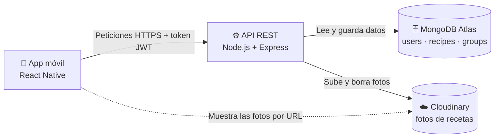

# CookPlan 🍳

## Descripción

CookPlan es una aplicación móvil para guardar, organizar y descubrir recetas de cocina.

Cada usuario puede:

- Registrarse, iniciar sesión, editar su perfil y borrar su cuenta.
- Crear sus propias recetas con ingredientes, pasos, tiempo de preparación, dificultad y una foto opcional tomada desde el teléfono.
- Ver sus recetas ordenadas alfabéticamente, editarlas y borrarlas.
- Organizar sus recetas en **grupos** (por ejemplo, "Cenas rápidas" o "Favoritas"). Una receta puede estar en varios grupos.
- Marcar cada receta como pública o privada.
- Explorar las recetas públicas de todos los usuarios.

---

## Arquitectura

- **App móvil** (`frontend/`): React Native. Habla solo con la API; nunca accede directamente a la base de datos.
- **API REST** (`backend/`): Node.js + Express. Autentica con JWT, aplica las reglas de negocio y valida los datos.
- **MongoDB Atlas**: guarda usuarios, recetas y grupos. Los ingredientes y pasos viven dentro de cada receta.
- **Cloudinary**: guarda las fotos de las recetas. La API sube la foto y guarda solo su URL; la app la muestra directamente desde esa URL.

---

## Documentación

| Documento | Contenido |
| --------- | --------- |
| [`backend/README.md`](backend/README.md) | Stack, arquitectura y cómo ejecutar la API. |
| [`backend/docs/DESIGN.md`](backend/docs/DESIGN.md) | Diseño de la base de datos en MongoDB. |
| [`frontend/README.md`](frontend/README.md) | Stack, arquitectura y cómo ejecutar la app móvil. |

---

### Proyecto realizado por:
- Marielv Mavárez
- Mariángeles Mavárez
  
Para la materia Programación de Dispositivos Móviles de la Universidad Rafael Urdaneta.
