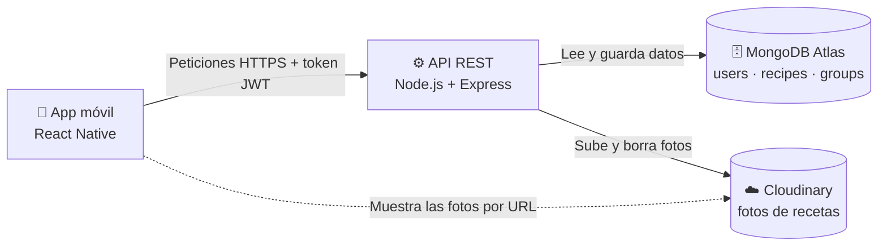
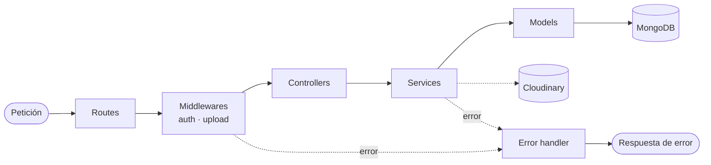

# CookPlan 🍳

## Descripción

CookPlan es una aplicación móvil para guardar, organizar y descubrir recetas de cocina.

Cada usuario puede:

- Registrarse, iniciar sesión, editar su perfil y borrar su cuenta.
- Crear sus propias recetas con ingredientes, pasos, tiempo de preparación, dificultad y una foto opcional tomada desde el teléfono.
- Ver sus recetas ordenadas alfabéticamente, editarlas y borrarlas.
- Organizar sus recetas en **grupos** (por ejemplo, "Cenas rápidas" o "Favoritas"). Una receta puede estar en varios grupos.
- Marcar cada receta como pública o privada.
- Explorar las recetas públicas de todos los usuarios.

---

## Arquitectura

### Vista general



- **App móvil** (`frontend/`): React Native. Habla solo con la API; nunca accede directamente a la base de datos.
- **API REST** (`backend/`): Node.js + Express. Autentica con JWT, aplica las reglas de negocio y valida los datos.
- **MongoDB Atlas**: guarda usuarios, recetas y grupos. Los ingredientes y pasos viven dentro de cada receta.
- **Cloudinary**: guarda las fotos de las recetas. La API sube la foto y guarda solo su URL; la app la muestra directamente desde esa URL.

### Capas del backend



Cada petición pasa por las mismas capas en orden. Si algo falla en cualquier punto, el error va al manejador de errores, que responde siempre con el mismo formato.

| Capa          | Responsabilidad                                              |
| ------------- | ------------------------------------------------------------ |
| `routes`      | Define los endpoints y los asocia a su controlador.          |
| `middlewares` | Autenticación, recepción de imágenes y manejo de errores.    |
| `controllers` | Reciben la petición HTTP y devuelven la respuesta.           |
| `services`    | Contienen la lógica de negocio.                              |
| `models`      | Esquemas de Mongoose: forma de los datos y sus validaciones. |

---

## Estructura de carpetas

```
cookplan/
├── README.md
├── .gitignore
├── docs/
│   └── requisitos.md
├── backend/
│   ├── README.md
│   ├── docs/
│   │   └── DESIGN.md
│   ├── src/
│   │   ├── config/
│   │   ├── models/
│   │   ├── routes/
│   │   ├── controllers/
│   │   ├── services/
│   │   ├── middlewares/
│   │   ├── utils/
│   │   ├── app.js
│   │   └── server.js
│   ├── .env.example
│   ├── package.json
│   └── pnpm-lock.yaml
└── frontend/
```

---

## Documentación

| Documento | Contenido |
| --------- | --------- |
| [`docs/requisitos.md`](docs/requisitos.md) | Requisitos funcionales de la aplicación. |
| [`backend/README.md`](backend/README.md) | Stack, reglas de negocio, validaciones, endpoints y cómo ejecutar la API. |
| [`backend/docs/DESIGN.md`](backend/docs/DESIGN.md) | Entidades, relaciones y diseño de la base de datos en MongoDB. |
| `frontend/README.md` | Documentación de la app móvil (a cargo del equipo de frontend). |

La documentación de la API y del deployment se irá completando en `backend/` a medida que avance el proyecto.
