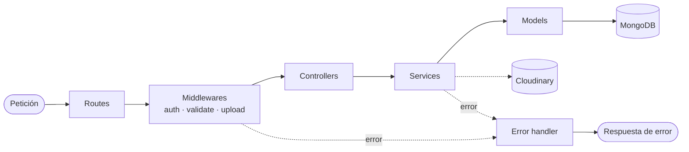

# CookPlan — Backend

API REST de CookPlan: usuarios, recetas y grupos.
Diseño de la base de datos: [`docs/DESIGN.md`](docs/DESIGN.md)
Contrato para el frontend: [`../docs/frontContract.md`](../docs/frontContract.md)

---

## Stack

| Capa          | Tecnología                         |
| ------------- | ---------------------------------- |
| Runtime       | Node.js (LTS ≥ 22)                 |
| Gestor de paquetes | pnpm                          |
| Framework     | Express 5                          |
| Base de datos | MongoDB (Atlas) + Mongoose         |
| Autenticación | JWT + bcrypt                       |
| Validación    | zod                                |
| Seguridad     | helmet, cors, express-rate-limit   |
| Imágenes      | multer + Cloudinary                |

---

## Estructura de carpetas

```
backend/
├── README.md
├── docs/
│   └── DESIGN.md
├── src/
│   ├── config/
│   │   ├── env.js              # Lee y valida las variables de entorno
│   │   ├── db.js               # Conexión a MongoDB
│   │   └── cloudinary.js       # Configuración de Cloudinary
│   ├── models/
│   │   ├── user.model.js
│   │   ├── recipe.model.js     # Incluye ingredientes, pasos y pertenencia a grupos
│   │   └── group.model.js
│   ├── schemas/                # Validación de entrada con zod
│   │   ├── auth.schema.js
│   │   ├── user.schema.js
│   │   ├── recipe.schema.js
│   │   └── group.schema.js
│   ├── routes/
│   │   ├── index.js            # Monta /health, /auth, /users, /recipes y /groups
│   │   ├── auth.routes.js
│   │   ├── user.routes.js
│   │   ├── recipe.routes.js
│   │   └── group.routes.js
│   ├── controllers/
│   │   ├── auth.controller.js
│   │   ├── user.controller.js
│   │   ├── recipe.controller.js
│   │   └── group.controller.js
│   ├── services/
│   │   ├── auth.service.js
│   │   ├── user.service.js
│   │   ├── recipe.service.js
│   │   ├── group.service.js
│   │   └── image.service.js    # Subida y borrado de fotos en Cloudinary
│   ├── middlewares/
│   │   ├── auth.js             # requireAuth: verifica el JWT
│   │   ├── validate.js         # Aplica un esquema zod al body o al query
│   │   ├── rateLimit.js        # Límite de intentos de login
│   │   ├── upload.js           # Recepción de la foto (multer)
│   │   └── errorHandler.js     # 404 y formato único de errores
│   ├── utils/
│   │   ├── AppError.js         # Error con status, código y detalles
│   │   ├── jwt.js              # Firmar y verificar tokens
│   │   ├── fieldRules.js       # Regex y valores permitidos
│   │   └── normalizer.js       # Normalizar nombres y escapar búsquedas
│   ├── app.js                  # Express: middlewares globales y rutas
│   └── server.js               # Conecta la base de datos y arranca el servidor
├── .env.example
├── package.json
├── pnpm-lock.yaml
└── pnpm-workspace.yaml
```

---

## Arquitectura



Cada petición pasa por las mismas capas en orden. Si algo falla en cualquier punto, el error va al manejador de errores, que responde siempre con el mismo formato.

| Capa          | Responsabilidad                                                      |
| ------------- | -------------------------------------------------------------------- |
| `routes`      | Define los endpoints y los asocia a sus middlewares y controlador.   |
| `middlewares` | Autenticación, validación, límite de intentos, imágenes y errores.   |
| `schemas`     | Reglas de validación de lo que llega en el body o el query (zod).    |
| `controllers` | Reciben la petición HTTP y devuelven la respuesta.                   |
| `services`    | Contienen la lógica de negocio.                                      |
| `models`      | Esquemas de Mongoose: forma de los datos y sus validaciones.         |
| `utils`       | Piezas compartidas: errores, JWT, reglas de campos, normalización.   |

---

## Variables de entorno

| Variable         | Ejemplo              | Descripción                    |
| ---------------- | -------------------- | ------------------------------ |
| `NODE_ENV`       | `development`        | `development` \| `production`  |
| `PORT`           | `3000`               | Puerto HTTP                    |
| `MONGODB_URI`    | `mongodb+srv://...`  | Cadena de conexión a MongoDB   |
| `JWT_SECRET`     | *(cadena aleatoria)* | Secreto para firmar los tokens |
| `JWT_EXPIRES_IN` | `7d`                 | Vigencia del token             |
| `CLOUDINARY_CLOUD_NAME` | `cookplan`    | Nombre de la cuenta de Cloudinary |
| `CLOUDINARY_API_KEY`    | *(clave)*     | API key de Cloudinary          |
| `CLOUDINARY_API_SECRET` | *(secreto)*   | API secret de Cloudinary       |

---

## Cómo ejecutar

1. Dentro de `backend/`: `pnpm install`.
2. Copiar `.env.example` a `.env` y completar los valores (pedirlos al equipo por un canal privado; `.env` nunca se sube al repo).
3. `pnpm dev`: arranca en `http://localhost:3000/api/v1` y se reinicia al guardar archivos `.js`. Los cambios en `.env` requieren reiniciar a mano.
4. Comprobar: `GET /api/v1/health` → `{ "data": { "ok": true } }`.

---

## Autenticación

- Registro e inicio de sesión (con correo y clave) devuelven un **JWT**.
- Todas las rutas, salvo `/auth/*` y `/health`, requieren el header `Authorization: Bearer <token>`.
- El dueño de recetas y grupos siempre se toma del token, nunca del body.
- Cerrar sesión se hace en el cliente, descartando el token.

---

## Reglas de negocio

**Usuarios**
- El correo y el nombre de usuario son únicos.
- La clave se guarda como hash y nunca se devuelve en las respuestas.
- Al editar el perfil, la clave es opcional: si no se envía, no cambia.
- Borrar la cuenta elimina también todas sus recetas y grupos.

**Recetas**
- Solo el dueño puede editar o borrar una receta; las de otros usuarios son de solo lectura.
- Un usuario no puede tener dos recetas con el mismo nombre. La comparación ignora mayúsculas, acentos y espacios extra.
- Todos los listados se devuelven en orden alfabético.
- Una receta tiene al menos 1 ingrediente y 1 paso. La posición de cada paso la asigna el servidor según el orden enviado.
- Una receta es **pública o privada** (por defecto, privada). Las públicas aparecen en Explorar para todos los usuarios; las privadas solo las ve su dueño.
- Una receta puede estar en cualquier cantidad de grupos.
- Borrar una receta la quita de todos sus grupos.

**Imágenes**
- Cada receta puede tener **una foto opcional**, subida desde el teléfono (galería o cámara).
- La imagen se guarda en **Cloudinary**; en la base de datos solo se guarda su URL. Nunca se guarda en el servidor ni en MongoDB.
- La foto se sube en un paso aparte: primero se crea la receta y luego se sube la imagen.
- Las respuestas de recetas incluyen `imageUrl`: la URL pública de la foto en Cloudinary, que el front usa directamente para mostrarla. Si la receta no tiene foto, `imageUrl` es `null` y el front muestra una imagen por defecto.
- Al reemplazar la foto, al borrar la receta o en los borrados en cascada (grupo o cuenta), el backend borra también la imagen de Cloudinary.

**Grupos**
- Un grupo solo contiene recetas de su dueño.
- Un usuario no puede tener dos grupos con el mismo nombre (misma comparación que en recetas).
- Quitar una receta de un grupo es un **borrado lógico**: la asociación no se elimina, se marca como inactiva (`isActive: false`) y la receta deja de aparecer en ese grupo. La receta sigue existiendo.
- Si la receta se vuelve a añadir al mismo grupo, la asociación se reactiva (`isActive: true`).
- Borrar un grupo borra también las recetas que están activas en él, aunque estén en otros grupos. Las que habían sido quitadas del grupo no se borran. El front debe advertirlo usando `recipeCount`.
- Cada grupo incluye `coverUrl`: la foto de su primera receta activa (orden alfabético) que tenga imagen, o `null` si ninguna tiene. Se calcula en cada petición, así que siempre está actualizada.

**Vistas**
- **Mis recetas**: todas las recetas del usuario, públicas y privadas, con filtro Todas / Públicas / Privadas.
- **Explorar**: recetas públicas de todos los usuarios, con su autor.

---

## Validaciones

Ningún campo obligatorio puede quedar vacío (se aplica `trim`). Cada campo tiene longitud mínima y máxima.

### Usuario

| Campo         | Obligatorio   | Reglas |
| ------------- | ------------- | ------ |
| `username`    | Sí            | 3–10 caracteres: letras, números, `_` y `.`, sin espacios. Regex: `^[A-Za-z0-9_.]{3,10}$` |
| `email`       | Sí            | Formato válido, máx. 254. Se guarda en minúsculas. |
| `password`    | Sí (registro) | 6–15 caracteres: letras, números y `_ - . / # $`, sin espacios. Regex: `^[A-Za-z0-9_.\-\/#$]{6,15}$` |
| `avatarColor` | No            | Uno de los colores de la paleta acordada con el front (`#RRGGBB`). |

### Receta

| Campo                    | Obligatorio | Reglas |
| ------------------------ | ----------- | ------ |
| `name`                   | Sí          | 2–50 caracteres. Único por usuario. |
| `description`            | Sí          | 10–200 caracteres. |
| `timeMinutes`            | Sí          | Entero, 1–1440. |
| `difficulty`             | Sí          | `facil` \| `media` \| `dificil` |
| `isPublic`               | No          | Booleano. Default `false` (privada). |
| `ingredients`            | Sí          | 1–30 elementos. |
| `ingredients[].name`     | Sí          | 2–20 caracteres. |
| `ingredients[].quantity` | Sí          | Número > 0 y ≤ 9999. |
| `ingredients[].unit`     | Sí          | `unidades` \| `g` \| `ml` \| `tazas` \| `cucharadas` |
| `steps`                  | Sí          | 1–30 elementos, en orden. |
| `steps[].description`    | Sí          | 3–150 caracteres. |
| `groupIds`               | No          | Ids de grupos propios. |

### Imagen de receta

Se envía como `multipart/form-data` en el campo `image`.

| Regla   | Valor |
| ------- | ----- |
| Formato | JPG, PNG o WebP |
| Tamaño  | Máx. 5 MB. El front debe comprimir y redimensionar la foto antes de enviarla. |
| Cantidad | Una imagen por receta. |

### Grupo

| Campo       | Obligatorio | Reglas |
| ----------- | ----------- | ------ |
| `name`      | Sí          | 2–20 caracteres. Único por usuario. |
| `recipeIds` | No          | Ids de recetas propias. |

**Parámetros de consulta en listados:** `q` (búsqueda por nombre), `page` (default 1), `limit` (1–50, default 20). En Mis recetas, además, `visibility` (`public` \| `private`; sin él se devuelven todas).

---

## Endpoints

Base URL: `/api/v1`

### Health

| Método | Ruta      | Descripción |
| ------ | --------- | ----------- |
| GET    | `/health` | Comprueba que la API responde. No requiere token. |

### Auth

| Método | Ruta             | Descripción     |
| ------ | ---------------- | --------------- |
| POST   | `/auth/register` | Crear cuenta    |
| POST   | `/auth/login`    | Iniciar sesión  |

### Usuario

| Método | Ruta        | Descripción |
| ------ | ----------- | ----------- |
| GET    | `/users/me` | Perfil y contadores de recetas y grupos |
| PATCH  | `/users/me` | Editar perfil |
| DELETE | `/users/me` | Borrar cuenta |

### Recetas

| Método | Ruta            | Descripción |
| ------ | --------------- | ----------- |
| GET    | `/recipes/mine` | Mis recetas (filtro `visibility`) |
| GET    | `/recipes`      | Explorar: solo recetas públicas (con `excludeMine=true` excluye las propias) |
| GET    | `/recipes/:id`  | Detalle de una receta propia o pública ajena (incluye `isMine`) |
| POST   | `/recipes`      | Crear receta |
| PATCH  | `/recipes/:id`  | Editar receta propia |
| DELETE | `/recipes/:id`  | Borrar receta propia (y su imagen) |
| PUT    | `/recipes/:id/image` | Subir o reemplazar la foto de una receta propia (`multipart/form-data`) |
| DELETE | `/recipes/:id/image` | Quitar la foto de una receta propia |

### Grupos

| Método | Ruta                            | Descripción |
| ------ | ------------------------------- | ----------- |
| GET    | `/groups`                       | Mis grupos (con `recipeCount` y `coverUrl`) |
| GET    | `/groups/:id`                   | Detalle del grupo y sus recetas |
| POST   | `/groups`                       | Crear grupo |
| PATCH  | `/groups/:id`                   | Renombrar grupo |
| DELETE | `/groups/:id`                   | Borrar grupo y sus recetas |
| POST   | `/groups/:id/recipes`           | Añadir recetas al grupo (o reactivarlas si habían sido quitadas) |
| DELETE | `/groups/:id/recipes/:recipeId` | Quitar una receta del grupo (borrado lógico) |

---

## Respuestas y errores

```json
// Éxito
{ "data": { } }

// Lista paginada
{ "data": [ ], "meta": { "page": 1, "limit": 20, "total": 2 } }

// Error
{ "error": { "code": "VALIDATION_ERROR", "message": "Hay campos inválidos.", "details": [ ] } }
```

| HTTP | Código                  | Cuándo |
| ---- | ----------------------- | ------ |
| 400  | `VALIDATION_ERROR`      | Datos inválidos |
| 401  | `UNAUTHORIZED`          | Token ausente, inválido o expirado |
| 401  | `INVALID_CREDENTIALS`   | Correo o clave incorrectos |
| 404  | `NOT_FOUND`             | El recurso no existe o no es del usuario |
| 409  | `EMAIL_TAKEN`           | Correo ya registrado |
| 409  | `USERNAME_TAKEN`        | Nombre de usuario ya registrado |
| 409  | `DUPLICATE_RECIPE_NAME` | Ya existe una receta propia con ese nombre |
| 409  | `DUPLICATE_GROUP_NAME`  | Ya existe un grupo propio con ese nombre |
| 413  | `FILE_TOO_LARGE`        | La imagen supera los 5 MB |
| 415  | `INVALID_FILE_TYPE`     | La imagen no es JPG, PNG ni WebP |
| 429  | `TOO_MANY_REQUESTS`     | Demasiados intentos de inicio de sesión |
| 500  | `INTERNAL_ERROR`        | Error inesperado |
