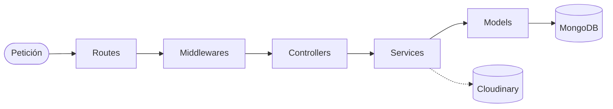

# CookPlan — Backend

API REST de CookPlan: usuarios, recetas y grupos.
Diseño de la base de datos: [`docs/DESIGN.md`](docs/DESIGN.md)

---

## Stack

| Capa          | Tecnología                         |
| ------------- | ---------------------------------- |
| Runtime       | Node.js (≥ 22)                     |
| Framework     | Express 5                          |
| Base de datos | MongoDB (Atlas) + Mongoose         |
| Autenticación | JWT + bcrypt                       |
| Validación    | zod                                |
| Imágenes      | multer + Cloudinary                |

---

## Arquitectura

| Carpeta (`src/`) | Responsabilidad                                         |
| ---------------- | ------------------------------------------------------- |
| `routes`         | Endpoints y sus middlewares.                            |
| `middlewares`    | Autenticación, validación, subida de imágenes y errores. |
| `schemas`        | Validación de los datos de entrada (zod).               |
| `controllers`    | Reciben la petición y devuelven la respuesta.           |
| `services`       | Lógica de negocio.                                      |
| `models`         | Modelos de Mongoose.                                    |
| `config`, `utils` | Configuración y funciones compartidas.                 |

---

## Cómo ejecutar

1. Dentro de `backend/`: `pnpm install`.
2. Copiar `.env.example` a `.env` y completar los valores.
3. `pnpm dev` → la API queda en `http://localhost:3000/api/v1`.
