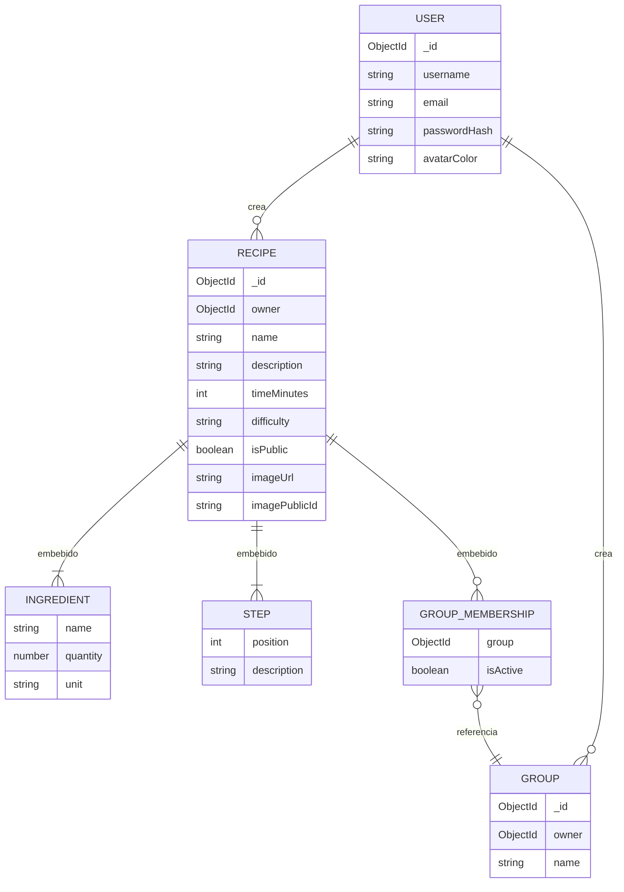

# CookPlan — Diseño de la base de datos

Base de datos **MongoDB** (Atlas), accedida con **Mongoose**. Tres colecciones: `users`, `recipes` y `groups`.
Todas incluyen `createdAt` y `updatedAt` automáticos.

---

## Diagrama

Los ingredientes, los pasos y la pertenencia a grupos se guardan **dentro** de cada receta (subdocumentos). Usuarios, recetas y grupos se relacionan por `ObjectId`.

---

## Entidades

### User — colección `users`

| Campo          | Tipo   | Descripción |
| -------------- | ------ | ----------- |
| `username`     | String | Nombre de usuario. Único. |
| `email`        | String | Correo de acceso. Único, en minúsculas. |
| `passwordHash` | String | Clave hasheada con bcrypt. Nunca se devuelve. |
| `avatarColor`  | String | Color del avatar (`#RRGGBB`). |

### Recipe — colección `recipes`

| Campo            | Tipo                | Descripción |
| ---------------- | ------------------- | ----------- |
| `owner`          | ObjectId → `users`  | Autor de la receta. |
| `name`           | String              | Título. Único por usuario. |
| `nameNormalized` | String              | Nombre en minúsculas y sin acentos. Uso interno: unicidad y búsqueda. |
| `description`    | String              | Resumen corto. |
| `timeMinutes`    | Number              | Tiempo de preparación en minutos. |
| `difficulty`     | String              | `facil` \| `media` \| `dificil` |
| `isPublic`       | Boolean             | `true`: aparece en Explorar. `false` (default): solo la ve su dueño. |
| `ingredients`    | [Ingredient]        | Lista de ingredientes (mín. 1). |
| `steps`          | [Step]              | Lista de pasos en orden (mín. 1). |
| `groups`         | [GroupMembership]   | Grupos a los que pertenece. Sin límite de cantidad. |
| `imageUrl`       | String \| null      | URL pública de la foto en Cloudinary. `null` si no tiene foto. |
| `imagePublicId`  | String \| null      | Identificador de la foto en Cloudinary. Uso interno: permite reemplazarla o borrarla. No se devuelve al front. |

#### Ingredient — subdocumento de Recipe

| Campo      | Tipo   | Descripción |
| ---------- | ------ | ----------- |
| `name`     | String | Nombre del ingrediente. |
| `quantity` | Number | Cantidad. |
| `unit`     | String | `unidades` \| `g` \| `ml` \| `tazas` \| `cucharadas` |

#### Step — subdocumento de Recipe

| Campo         | Tipo   | Descripción |
| ------------- | ------ | ----------- |
| `position`    | Number | Número del paso (1, 2, 3…). Lo asigna el servidor. |
| `description` | String | Instrucción del paso. |

#### GroupMembership — subdocumento de Recipe

| Campo      | Tipo                | Descripción |
| ---------- | ------------------- | ----------- |
| `group`    | ObjectId → `groups` | Grupo al que pertenece la receta. Una entrada por grupo. |
| `isActive` | Boolean             | `true`: la receta está en el grupo. `false`: fue quitada (**borrado lógico**). Si se vuelve a añadir, pasa a `true`. |

Solo las entradas activas cuentan para mostrar las recetas de un grupo y su `recipeCount`.

### Group — colección `groups`

| Campo            | Tipo               | Descripción |
| ---------------- | ------------------ | ----------- |
| `owner`          | ObjectId → `users` | Dueño del grupo. |
| `name`           | String             | Nombre del grupo. Único por usuario. |
| `nameNormalized` | String             | Nombre en minúsculas y sin acentos. Uso interno: unicidad y búsqueda. |
