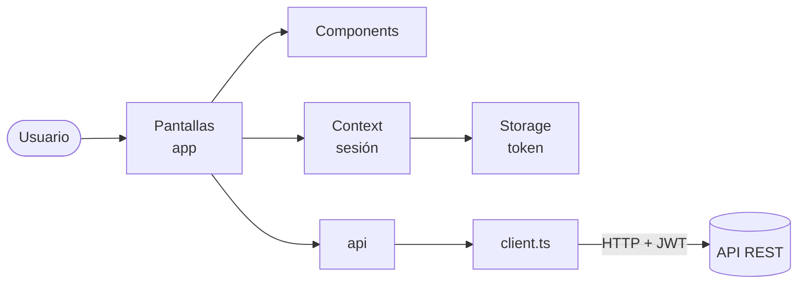

# CookPlan — Frontend

App móvil de CookPlan, hecha con React Native y Expo. Consume la API del [`backend/`](../backend/README.md).

---

## Stack

| Capa               | Tecnología                                  |
| ------------------ | ------------------------------------------- |
| Framework          | Expo SDK 57 + React Native 0.86             |
| Lenguaje           | TypeScript                                  |
| Navegación         | Expo Router (rutas por archivos)            |
| Gestor de paquetes | pnpm                                        |
| Sesión             | JWT guardado con `expo-secure-store`        |
| Fotos              | `expo-image-picker` (galería y cámara)      |
| Iconos             | `@expo/vector-icons`                        |

---

## Cómo ejecutar

1. Instalar dependencias: `pnpm install`.
2. Arrancar el backend (ver [`backend/README.md`](../backend/README.md)) y luego la app: `pnpm start`.
3. Escanear el QR con **Expo Go** (debe soportar **SDK 57**).

El teléfono y la PC tienen que estar en la misma red WiFi. Si no conecta, usar `pnpm start --tunnel`.

---

## Arquitectura

Las pantallas nunca llaman al backend directamente: piden los datos a `api`, y `client.ts` es el único que hace `fetch` y añade el token.

| Carpeta (`src/`) | Responsabilidad                                                  |
| ---------------- | ---------------------------------------------------------------- |
| `app`            | Pantallas y navegación (Expo Router). Cada archivo es una ruta.  |
| `components`     | Piezas de UI reutilizables.                                      |
| `api`            | Llamadas al backend, un archivo por recurso.                     |
| `context`        | Estado global de la sesión.                                      |
| `storage`        | Guarda el token en el teléfono.                                  |
| `styles`         | Colores, tipografía y estilos compartidos.                       |
| `types`          | Tipos de TypeScript de las respuestas de la API.                 |
| `utils`          | Funciones de apoyo.                                              |
